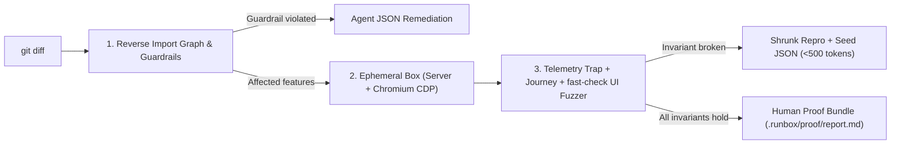

# runbox

**Framework-agnostic downstream verification harness for AI coding agents.**

`runbox` bridges the gap between AI code generation and production trust. Instead of relying on `tsc`, happy-path unit tests, or manual diff review, `runbox` maps `git diff` through your dependency graph to affected features, enforces deterministic architectural guardrails, boots an isolated runtime box in headless Chromium, fuzzes live UI state machines with `fast-check`, and emits both:

1. **A `<500-token` self-healing JSON oracle (`--agent`)** with a deterministic `--seed`, shrunk minimal reproduction steps, and LLM remediation guidance.
2. **A Human Proof Bundle (`.runbox/proof/report.md`)** with an invariant scorecard, captured screenshots, and an auto-generated Mermaid `stateDiagram-v2` of verified transitions.

---

## Why `runbox`? (The Downstream Gap)

AI coding agents made generating code cheap—shifting the engineering bottleneck to **upstream constraints** (guardrails, types, architecture) and **downstream verification** (proving runtime invariants without reading 600-line diffs).



---

## Quick Start

```bash
# Install / build locally
pnpm install
pnpm run build

# 1. Auto-discover routes, aliases, server command, and generate runbox.config.ts + SKILL.md
npx runbox init

# 2. Fast static pre-flight: run Golden Rule guardrails & resolve git diff to affected features
npx runbox check --diff

# 3. Boot ephemeral box, verify affected features + property fuzzing, and write Proof Bundle
npx runbox verify --diff --fuzz

# 4. Agent mode: suppress TUI noise and emit a compact <500-token JSON diagnosis
npx runbox verify --diff --fuzz --agent
```

---

## Framework-Agnostic Route & Alias Discovery

`runbox init` inspects your repository using three universal strategies rather than hardcoding to a single framework:

| Archetype | Frameworks Covered | How `runbox` Discovers Routes & Ownership |
| :--- | :--- | :--- |
| **File-System Routers** | Next.js (App & Pages), SvelteKit, Remix, Nuxt | Scans `app/**/page.*`, `pages/**`, and `src/routes/**/+page.*`, normalizing `[id]` / `$id` to `:id` with sample paths. |
| **JSX `<Route>` Trees** | Vite + React Router SPAs | Brace-aware scanning of nested `<Route path="..." element={<Comp />} />` declarations and `tsconfig.json` `paths` aliases. |
| **Config-Array Routers** | Catalyst (`catalyst-core`), React Router v6/v7 data routers, TanStack/Vue configs | Balanced-brace parsing of nested `{ path, element \| component, children }` arrays, `split(() => import(...))` wrappers, and `package.json` `_moduleAliases`. |

If your bundler uses custom aliases not listed in `tsconfig.json`, `runbox` reads `package.json` `_moduleAliases` and resolves conventional `@<folder>/*` workspace aliases automatically.

---

## Configuration (`runbox.config.ts`)

```ts
import { defineConfig } from "runbox";

export default defineConfig({
  framework: "catalyst-core",
  server: {
    command: "npm start",
    readyPath: "/",
    configPath: "config/config.json",
  },
  guardrails: [
    {
      id: "no-server-in-client",
      files: ["src/js/**"],
      forbidImportsFrom: ["server/**", "@server", "@server/**"],
      remediation:
        "Universal/client modules must not import from server/. Move server-only logic behind an API endpoint or server data fetcher.",
    },
  ],
  invariants: {
    noConsoleErrors: true,
    noUncaughtExceptions: true,
    noHydrationMismatch: true,
    noServer5xx: true,
  },
  features: [
    {
      id: "route-cart",
      name: "Cart (Cart)",
      route: "/cart",
      files: ["src/js/containers/Cart/**", "src/js/components/CouponBox.js"],
      journey: async ({ page, step }) => {
        await step("Add item & apply SAVE20 coupon", async () => {
          await page.click('[data-testid="add-item"]');
          await page.fill('[data-testid="coupon-input"]', "SAVE20");
          await page.click('[data-testid="apply-coupon"]');
        });
      },
      assertInvariants: async ({ page }) => {
        const text = await page.textContent('[data-testid="cart-total"]');
        const total = Number((text || "").replace("$", ""));
        if (Number.isNaN(total) || total < 0) {
          throw new Error(`Cart total invariant violated: ${text}`);
        }
      },
      fuzz: {
        enabled: true,
        scopeSelector: '[data-testid="cart-panel"]',
        steps: 6,
        runs: 10,
      },
    },
  ],
});
```

---

## CLI Reference

| Command | Flags | Purpose |
| :--- | :--- | :--- |
| `runbox init` | `-f, --force`, `--agent` | Discovers routes, aliases, and dev/start scripts; generates `runbox.config.ts` and `.agents/skills/runbox/SKILL.md`. |
| `runbox check` | `--diff`, `--tier <p0\|p1\|p2>`, `-c, --config <path>`, `--agent` | Runs static Golden Rule guardrails and walks the reverse import graph from `git status`/`git diff` to affected features. |
| `runbox verify` | `--diff`, `--feature <id>`, `--tier <p0\|p1\|p2>`, `--fuzz`, `--seed <hex>`, `--url <url>`, `-c, --config <path>`, `--agent` | Runs pre-flight guardrails, boots the server (or attaches to `--url`), runs journeys + telemetry traps + `fast-check` UI fuzzing, and writes `.runbox/proof/report.md`. |
| `runbox discover [route]` | `--url <url>`, `-c, --config <path>`, `--agent` | Opens a live route in headless Chromium and prints interactive controls (`data-testid`, buttons, inputs) and same-origin links. |

---

## Enterprise `v0.2` Capabilities (`feat/v0.2-enterprise`)

### 1. Federated Feature Contracts (`defineFeature()`) & Blast-Radius Tiers
Large repositories can co-locate `*.runbox.ts` contracts next to vertical pods instead of maintaining one giant config file. `runbox` auto-discovers `src/**/*.runbox.{ts,js,mjs}` and `.runbox/features/**/*.{ts,js}` (defaulting `files` ownership to the feature file's directory when omitted):

```ts
// src/js/containers/Cart/Cart.runbox.ts
import { defineFeature } from "runbox";

export default defineFeature({
  id: "route-cart",
  name: "Cart (Cart)",
  route: "/cart",
  tier: "p0", // p0 (critical revenue) | p1 (default) | p2
  persona: "care-plan-member",
  mocks: [
    {
      urlPattern: "**/api/promo**",
      method: "GET",
      body: { code: "SAVE20", discount: 20 },
    },
  ],
  journey: async ({ page, step }) => { /* ... */ },
  assertInvariants: async ({ page }) => { /* ... */ },
});
```

In root `runbox.config.ts`, set `blastRadius: { maxLocalFeatures: 2 }` to prioritize `p0` features first and defer lower-tier routes during high-fanout shared edits, or filter explicitly via `runbox verify --tier p0`.

### 2. Built-In Guardrail Presets (`presets`)
Replace boilerplate guardrail arrays with composable presets:
- `presets.ssr()` — Blocks `server/**` and `@server/**` imports inside universal/client modules.
- `presets.catalyst()` — Includes `presets.ssr()` and enforces lazy `split(() => import('@containers/...'))` route declarations in `src/js/routes/index.*`.
- `presets.strictAgent()` — Blocks fragile `setTimeout` / `requestIdleCallback` race-condition workarounds.

### 3. Personas & Deterministic API Mocks
Define reusable `personas` (`cookies`, `localStorage`, `headers`) and `mocks` (`page.route` URL interception) in `runbox.config.ts` or per-feature so verification runs deterministically without flaky staging dependencies:

```ts
import { defineConfig, presets } from "runbox";

export default defineConfig({
  framework: "catalyst-core",
  featureGlobs: ["src/**/*.runbox.ts"],
  blastRadius: { maxLocalFeatures: 2 },
  personas: {
    "care-plan-member": {
      id: "care-plan-member",
      cookies: [{ name: "session", value: "vip-token" }],
      localStorage: { carePlan: "active", pincode: "110001" },
      headers: { "x-runbox-persona": "care-plan-member" },
    },
  },
  guardrails: presets.catalyst(),
});
```

---

## Dual Output: Agent Self-Healing JSON vs. Human Proof Bundle

### For Agents (`--agent`)
When `fast-check` finds a bug (e.g., applying `SAVE20` and clicking `-1 Qty` produces `$-10`), it shrinks the random click sequence and outputs a compact `<500-token` JSON oracle:

```json
{
  "status": "failed",
  "affectedFeatures": ["route-cart"],
  "skippedFeatures": ["route-home", "route-orders"],
  "guardrailViolations": [],
  "failures": [
    {
      "featureId": "route-cart",
      "violatedInvariant": "domainInvariant",
      "message": "Cart total invariant violated: $-10",
      "seed": "0x42",
      "replayCommand": "runbox verify --feature route-cart --fuzz --seed 0x42 --agent",
      "minimalReproductionSteps": ["Click \"dec-qty\""],
      "remediation": "Fix state/business invariant violation in src/js/containers/Cart/**: Cart total invariant violated: $-10"
    }
  ],
  "proofReportPath": ".runbox/proof/report.md"
}
```

### For Humans (`.runbox/proof/report.md`)
Every `runbox verify` run generates a reviewable Markdown report containing:
- **Invariant Scorecard** (`Console Errors`, `Uncaught Exceptions`, `Hydration Mismatches`, `Server 5xx Responses`, `Domain Invariants`)
- **Verified UI Statechart** (`mermaid stateDiagram-v2` covering every journey step and fuzzed transition)
- **Failure Counterexamples** (if failed, with exact `--seed` replay command and minimal steps)
- **Captured Screenshots** in `.runbox/proof/screenshots/`

---

## Example App

- **[vmlgtm/catalyst-shop](https://github.com/vmlgtm/catalyst-shop)** — Multi-route Catalyst (`catalyst-core`) SSR pharmacy & e-commerce app configured with `runbox.config.ts`, 4 route journeys, domain invariants, and `fast-check` fuzzing.

---

## Development

```bash
pnpm install
pnpm run typecheck
pnpm run build
pnpm test
node ./dist/cli.js check
```

## License

MIT
