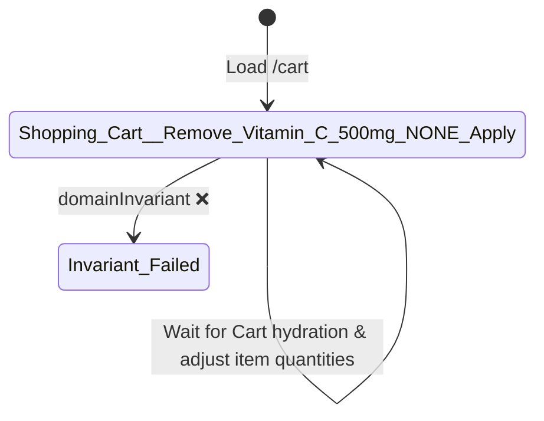
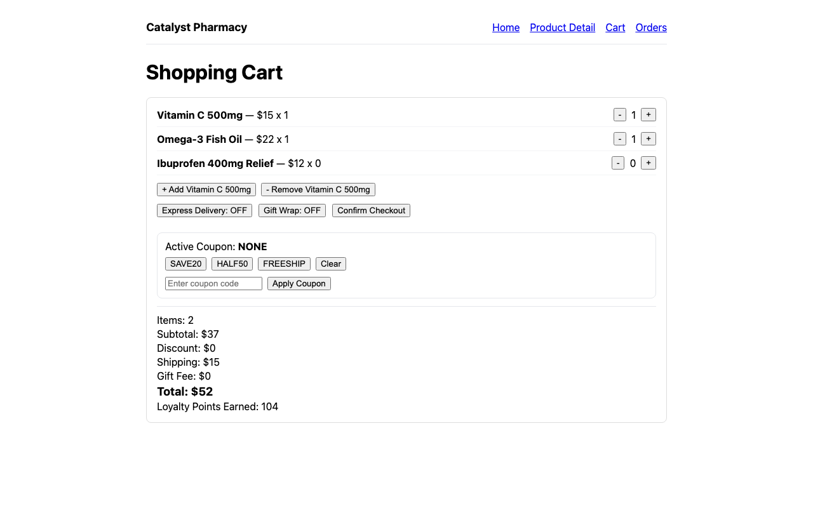

# runbox Proof Bundle — FAILED ❌

- **Duration:** 7.05s
- **Affected Features Tested:** `route-cart`
- **Skipped Features:** `route-home`, `route-orders`, `route-product-id`

## Invariant Scorecard

| Invariant | Violations | Status |
| :--- | :---: | :---: |
| Console Errors | 0 | ✅ |
| Uncaught Exceptions | 0 | ✅ |
| Hydration Mismatches | 0 | ✅ |
| Server 5xx Responses | 0 | ✅ |
| Domain Invariants | 1 | ❌ |

## Features Verified

| Feature | Route | Journey Steps | Fuzz Runs | Transitions | Seed | Result |
| :--- | :--- | :---: | :---: | :---: | :--- | :---: |
| `route-cart` (Cart (Cart)) | `/cart` | 2 | 0 | 3 | `0x42` | ❌ Failed |

## Verified UI Statechart

## Failure Counterexamples

### `route-cart` — `domainInvariant`
- **Error:** Cart discount invariant violated: discount=$70 > subtotal=$64
- **Replay Command:** `npx runbox verify --feature route-cart --fuzz --seed 0x42`
- **Minimal Reproduction Steps:**
  1. Load /cart
- **Remediation:** Fix state/business invariant violation in src/js/containers/Cart/**: Cart discount invariant violated: discount=$70 > subtotal=$64

## Captured Evidence

- [route-cart-initial.png](screenshots/route-cart-initial.png)
- [route-cart-failed.png](screenshots/route-cart-failed.png)

